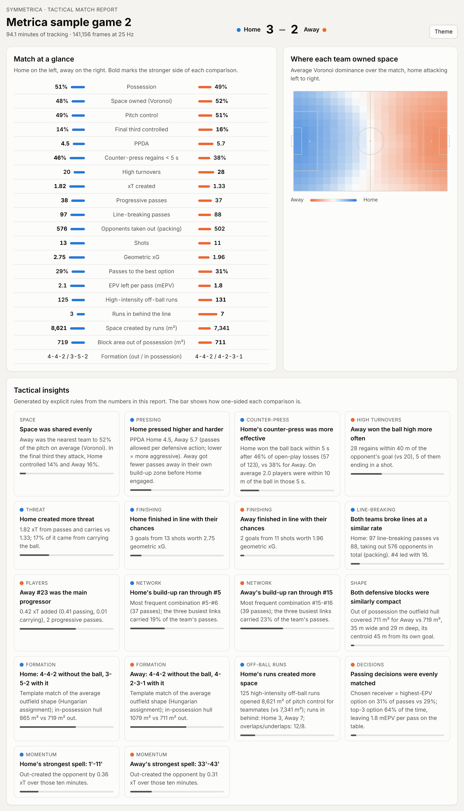
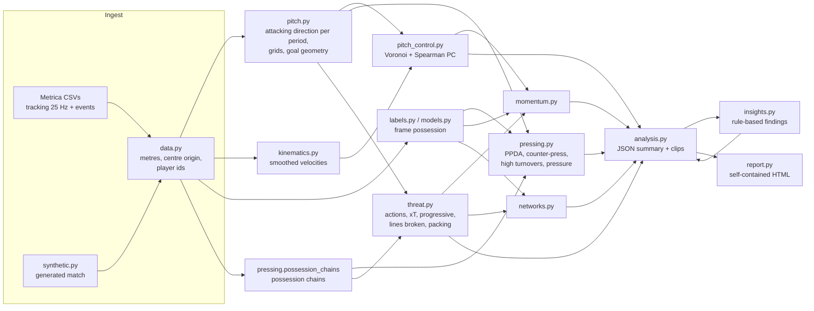
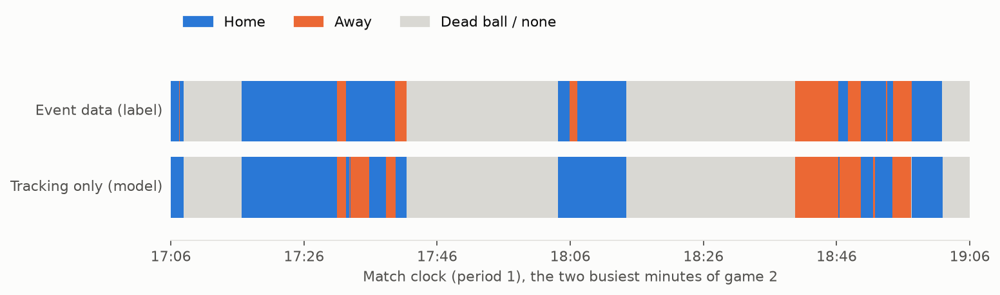
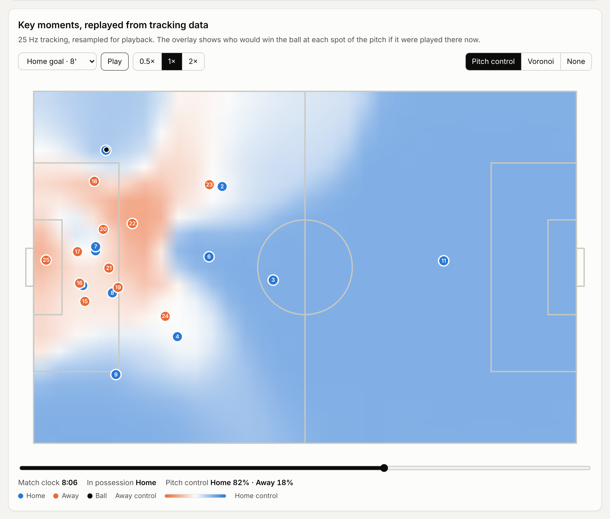
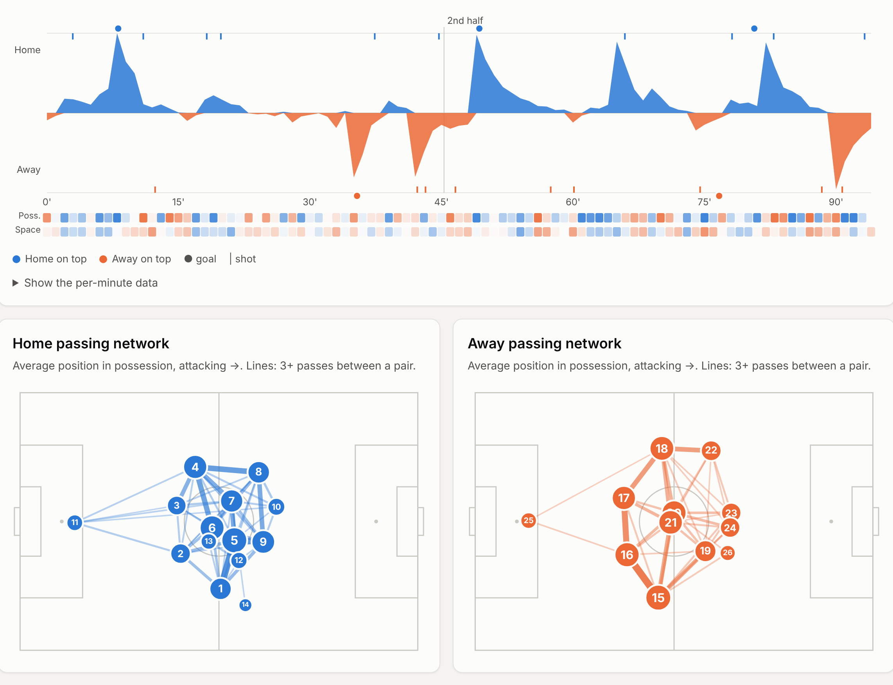

# symmetrica

[](https://github.com/yangpeduto/symmetrica/actions/workflows/tests.yml)

**Tactical analytics from football tracking data: possession, space, pressing and threat, frame by frame.**

Event data tells you *when* something happens on the ball. Tracking data tells
you *where* all 22 players and the ball are, 25 times a second. symmetrica
combines the two to answer tactical questions an analyst would ask about a
match: who had the ball, who owned the space, who pressed and where, which
passes cut through the opponent, and when the momentum swung. It ends in a
single interactive HTML match report.

Data: the open [Metrica Sports sample data](https://github.com/metrica-sports/sample-data)
(two anonymised matches, synchronised tracking + event data, 25 Hz).



## What it computes

| Question | Model | Module |
|---|---|---|
| Who has the ball, every frame? | Event-derived labels + a tracking-only *control with memory* model (93.4 % out-of-sample) | `labels.py`, `models.py` |
| Who owns which space? | Voronoi dominance (every frame) and Spearman probabilistic pitch control | `pitch_control.py` |
| How hard and how high do they press? | PPDA, tracking pressure on the ball, counter-press regains < 5 s, high turnovers, recovery zones | `pressing.py` |
| Which actions create danger? | Expected threat (xT) by value iteration, inferred carries, progressive passes | `threat.py` |
| Which passes cut through the block? | Defensive lines from tracking, line-breaking passes, packing (opponents taken out) | `threat.py` |
| When was each team on top? | xT momentum timeline with possession and space strips | `momentum.py` |
| How do they build up? | Passing networks at average in-possession positions | `networks.py` |
| What should a coach read first? | Rule-based tactical insights, each traceable to a number in the report | `insights.py` |

## Architecture



Everything below `data.py` works on plain pandas / NumPy tables in one
coordinate frame (metres, origin at the centre spot, x along the pitch), so
every model runs unchanged on the Metrica games and on synthetic matches.
Teams swap ends at half time; each metric converts to the acting team's
**attacking frame** (rotate 180° when the team attacks towards −x), which is
detected from the players' centroids at each kick-off.

## The models

### Possession (frame level)

Labels come from the event feed: a frame belongs to the team of the last
on-ball event (pass, shot, recovery, set piece, ball lost); after the ball
goes out or a foul is given nobody has it until play restarts. The
tracking-only estimator keeps the last team in control while the ball
travels and only switches when a player is within a control radius of a slow
enough ball; its thresholds are grid-searched on one match and tested on the
other.

| Model | Game 1 → test on Game 2 | Game 2 → test on Game 1 |
|---|---|---|
| Nearest player to the ball | 80.9 % | 80.3 % |
| **Control with memory** | **93.4 %** | **93.4 %** |
| Control with memory, ignoring ±0.5 s around a change of possession | 94.7 % | 94.6 % |



### Pitch control and space

**Voronoi dominance.** A location $r$ belongs to the team of the nearest
player. Vectorised over frames × cells × players, it runs on every frame of a
match (~8,000 frames/s).

**Probabilistic pitch control** (Spearman, 2018). The ball needs
$t_\text{ball}(r) = \lVert r - b \rVert / v_\text{ball}$ to reach $r$.
Player $j$, at position $p_j$ with velocity $v_j$, keeps running for a
reaction time and then sprints straight to $r$:

$$\tau_j(r) = t_\text{react} + \frac{\lVert r - (p_j + v_j\,t_\text{react}) \rVert}{v_\text{max}}$$

Arrival is uncertain, so the chance he is there by time $t$ is logistic in
$t-\tau_j$, and once there he controls the ball at rate $\lambda$:

$$\frac{dP_j}{dt} = \Big(1 - \sum_k P_k(t)\Big)\, f_j(t)\, \lambda_j, \qquad f_j(t) = \frac{1}{1 + e^{-\frac{\pi}{\sqrt{3}\,\sigma}(t - \tau_j)}}$$

integrated from $t_\text{ball}$ until the probabilities sum to 1 − 0.01. A
team's control of $r$ is $\sum_{j \in \text{team}} P_j$. Defaults:
$t_\text{react}$ = 0.7 s, $v_\text{max}$ = 5 m/s, $\sigma$ = 0.45 s,
$\lambda$ = 4.3 s⁻¹, $v_\text{ball}$ = 15 m/s. The integration is vectorised
over all cells and players at once and starts at the earliest plausible
arrival, so a full 50 × 32 surface costs ~29 ms.



### Pressing and counter-pressing

The event feed is split into **possession chains** (runs of on-ball events by
one team with no stoppage). A chain that follows an opponent chain without a
stoppage is an open-play turnover.

$$\text{PPDA}_T = \frac{\text{opponent passes in zone}}{\text{defensive actions of } T \text{ in zone}}$$

where the zone is the 60 % of the pitch furthest from $T$'s goal and defensive
actions are ground challenges, tackles and interceptions made while the
opponent has the ball (aerial duels excluded, as in Opta's definition).
Lower PPDA means a more aggressive press.

- **Counter-press rate**: share of open-play losses won back within 5 s. From
  tracking, the average number of the losing team's players within 10 m of
  the ball in that window measures how many joined the press.
- **High turnovers**: open-play regains within 40 m of the opponent's goal,
  and how many of those chains end in a shot.
- **Pressure on the ball** (tracking): per frame, defenders within 5 m of the
  ball and the distance of the nearest one.

### Threat, progression and line-breaking

**Expected threat** (Singh, 2019) on a 12 × 8 grid in the attacking frame.
With shot probability $s_c$, move probability $m_c$, successful-move
transition matrix $T_{c \to z}$ and shot conversion $x_c$:

$$xT_c = s_c\, x_c + m_c \sum_z T_{c \to z}\, xT_z$$

solved by value iteration (converges in ~60 iterations). Two matches are thin
for 96 cells, so counts are smoothed with a Gaussian kernel over neighbouring
source cells, and $x_c$ comes from a geometric prior,

$$\operatorname{logit} x_c = -1.75 + 2.22\,\theta_c - 0.082\,d_c$$

($\theta$ = angle subtended by the goal mouth, $d$ = distance to goal),
calibrated to public rule-of-thumb values (≈0.6 six-yard box, ≈0.25 penalty
spot, ≈0.11 edge of the box, ≈0.04 at 25 m). The value of an action is
$xT(\text{end}) - xT(\text{start})$. Carries are not in Metrica's feed and are
inferred as the ball's displacement (≥ 3 m) between consecutive touches of the
same player within a chain.

- **Progressive pass** (Wyscout's rule): ≥ 30 m closer to goal inside the own
  half, ≥ 15 m when crossing halfway, ≥ 10 m inside the opponent half.
- **Defensive lines**: at the moment of each pass, the opponent outfielders'
  x positions (in the passer's attacking frame) are cut at the two largest
  gaps into up to three lines.
- **Line-breaking pass**: a completed pass that starts ≥ 2 m behind a line and
  is received ≥ 2 m beyond it. Counted per line broken.
- **Packing**: opponents goal-side of the ball when the pass is played minus
  opponents goal-side when it is received, both read from tracking.

### Momentum, networks, insights

- **Momentum** $m_t = \text{EWM}_{5\,\text{min}}\big(xT^\text{home}_t - xT^\text{away}_t\big)$,
  scaled to $[-1, 1]$, with per-minute possession and Voronoi-space strips.
- **Passing networks** place each player at his average position *while his
  team has the ball* (from tracking, both halves folded into one attacking
  direction); edges are completed passes between a pair.
- **Insights** are produced by explicit rules (e.g. "PPDA 4.5 vs 5.7 → Home
  pressed higher"), each carrying the numbers it is based on and a one-sidedness
  score; near-ties are reported as evenly matched instead of as a win.



## Results on the Metrica sample games

All values from `python scripts/report.py --game 1 --game 2 --json` (xT fitted
on both games pooled).

| | Game 1 Home | Game 1 Away | Game 2 Home | Game 2 Away |
|---|---|---|---|---|
| Goals | 3 | 0 | 3 | 2 |
| Possession | 52 % | 48 % | 51 % | 49 % |
| Space owned (Voronoi) | 52 % | 48 % | 48 % | 52 % |
| PPDA | 6.7 | 5.2 | 4.5 | 5.7 |
| Counter-press regains < 5 s | 45 % | 41 % | 46 % | 38 % |
| High turnovers | 16 | 15 | 20 | 28 |
| xT created | 2.73 | 0.76 | 1.82 | 1.33 |
| Progressive passes | 43 | 28 | 38 | 37 |
| Line-breaking passes | 102 | 95 | 97 | 88 |
| Opponents taken out (packing) | 557 | 399 | 576 | 502 |
| Shots / geometric xG | 18 / 3.84 | 6 / 0.35 | 13 / 2.75 | 11 / 1.96 |

Game 1 reads as a one-sided 3–0 in threat terms (xT 2.73 vs 0.76, xG 3.84 vs
0.35) even though possession and space were almost even: the home side did
more with the ball rather than having more of it. Game 2 was closer in every
dimension, and away won the ball high more often (28 vs 20 high turnovers)
while home pressed more aggressively by PPDA.

Metrica's feed logs more duels than commercial providers, so absolute PPDA
values sit below typical league tables (8–12); comparisons between the two
teams are what the number is for here.

## Benchmarks

Measured by `python scripts/benchmark.py` on Metrica game 2 (94 min, 141,156
frames), Python 3.13, NumPy 2.5, 4 vCPUs. Raw output in
[`results/benchmarks.json`](results/benchmarks.json).

| Step | Time |
|---|---|
| Load + parse tracking (2 CSVs) | 0.6 s |
| Velocities, every player, every frame | 0.3 s |
| Pitch control, one frame, 50 × 32 grid | 29 ms median (37 ms p95) |
| Pitch control, one frame, 32 × 21 grid | 12 ms median (16 ms p95) |
| Voronoi dominance, every frame of the match | 17 s (≈8,200 frames/s) |
| Full report: every model + 5 animated clips with pitch control | 17 s |
| Report file size (self-contained HTML) | 0.7 MB |

## The interactive report

`scripts/report.py` writes one HTML file per match with the data embedded and
all drawing done in vanilla JS (canvas + SVG): no network requests, no build
step, works offline and as an e-mail attachment. It contains

- a team comparison and the average space-dominance map,
- the automated tactical insights,
- **animated replays** of the goals and the biggest line-breaking passes, with a
  pitch-control or live Voronoi overlay, scrubbing and speed control,
- the momentum timeline with goals, shots, possession and space strips (hover
  for per-minute values, or open the data table),
- passing networks for both teams,
- recovery maps with the high-turnover zone and PPDA per 15 minutes,
- the fitted xT surface with the most valuable passes, and a progression
  leaderboard,
- light and dark themes, phone layout.

A generated report for game 2 is committed at
[`reports/game2.html`](reports/game2.html): download it and open it in a browser.

## Quickstart

```bash
python -m venv .venv
```

```bash
.venv/bin/pip install -e ".[dev]"          # Windows: .venv\Scripts\pip
```

```bash
.venv/bin/python scripts/report.py --synthetic        # offline demo, no download
```

```bash
.venv/bin/python scripts/report.py --game 1 --game 2  # downloads the Metrica data on first run
```

```bash
.venv/bin/python -m pytest                            # 52 tests, ~5 s, no data needed
```

The original possession study and its figures:

```bash
.venv/bin/python scripts/evaluate.py && .venv/bin/python scripts/figures.py && .venv/bin/python scripts/animate.py
```

Use it as a library:

```python
from symmetrica import data, analysis, report

track, events = data.tracking(2), data.events(2)
summary = analysis.analyse_match(track, events, name="Game 2")
report.write_report(summary, "reports/game2.html")
summary["pressing"]["home"]["ppda"], summary["threat"]["away"]["xt_generated"]
```

The raw data is downloaded from Metrica's repository into `data/` and is not
redistributed here.

## Tests

`tests/` holds 52 pytest cases that run without the Metrica download. Unit
tests build small hand-placed scenes whose answer is known analytically; the
integration tests run the full pipeline on a generated match.

- **Pitch control**: probabilities sum to 1 within tolerance everywhere; a
  mirrored 1 v 1 gives mirrored surfaces and an exact 50/50 on the midline; a
  player owns the ground at his feet; running towards a space wins it; a
  defender advantage κ > 1 shifts contested balls; Voronoi matches brute force;
  attacking-frame bookkeeping across half time.
- **Pressing**: possession chains split on team changes and stoppages; PPDA
  counts only defensive actions in the pressing zone (aerials excluded);
  counter-press regains respect the time window and ignore set-piece restarts;
  high-turnover distance, zones and tracking pressure counts.
- **Threat**: value iteration on a designed three-cell chain reproduces the
  closed-form xT; geometric xG is monotone and symmetric; carry inference;
  every branch of the progressive rule; defensive lines of a 4-4-2; line-break
  margins; packing on a constructed pass.
- **Data, kinematics, momentum, networks, insights**: CSV parsing and the metre
  transform, velocity recovery and half-time handling, momentum scaling,
  network positions in the attacking frame, insight wording on wins, near-ties
  and missing values.
- **Report**: the summary is strict JSON, clips decode to the right grid, the
  HTML has no external resources and escapes a hostile match name, and (when
  Node + Playwright are available) the page renders in headless Chromium at
  phone width with no console errors.

## Project layout

```
src/symmetrica/
  data.py            Metrica CSV loading, metre coordinates, player ids
  pitch.py           grids, attacking direction, goal geometry, zones
  kinematics.py      smoothed velocities, per-frame snapshots
  labels.py          event-derived possession labels
  models.py          tracking-only possession estimators
  pitch_control.py   Voronoi dominance and Spearman pitch control
  pressing.py        possession chains, PPDA, counter-press, recoveries, pressure
  threat.py          actions + carries, xT, progressive / line-breaking passes, packing
  momentum.py        momentum timeline
  networks.py        passing networks
  insights.py        rule-based tactical insights
  analysis.py        runs everything on one match -> JSON summary
  report.py          renders report_template.html with the summary embedded
  synthetic.py       generated match for tests and demos
scripts/             evaluate.py, figures.py, animate.py, report.py, benchmark.py
tests/               pytest suite
```

## Limitations

- **Two matches.** The xT surface is fitted on ~3,100 actions, which is why it
  is kernel-smoothed and uses a geometric xG prior instead of the ~50 shots in
  the data. Values are on a sensible scale but should not be compared with
  surfaces fitted on a season.
- **No ball height.** A lofted ball over a player still looks controllable to
  the possession model and to pitch control; line-breaking passes cannot tell
  "through" from "over" the line.
- **Pitch control is the standard simplified model**: one top speed and
  reaction time for everyone, no goalkeeper-specific parameters, no body
  orientation.
- **Event-derived possession is the ground truth** for possession-conditioned
  metrics, so a few seconds around each change of possession are ambiguous by
  construction.
- **Defensive lines from natural breaks** assume a compact block; against a
  very staggered shape the number of "lines" is less meaningful.

Next steps: learn pitch-control parameters from the tracking data (who
actually reaches loose balls), add an off-ball run / space-creation metric on
top of pitch control, and extend the insight rules to compare spells within a
match rather than only the two teams.

## References

- W. Spearman (2018). *Beyond Expected Goals.* MIT Sloan Sports Analytics Conference.
- K. Singh (2019). *Introducing Expected Threat (xT).*
- L. Shaw, *Friends of Tracking* — open implementation of Spearman's model.
- Metrica Sports, *Sample Data* (tracking + events).

## Credits

Tracking and event data: © Metrica Sports, published as open sample data.
Built by Yang Peduto ([LinkedIn](https://www.linkedin.com/in/yang-peduto)).
