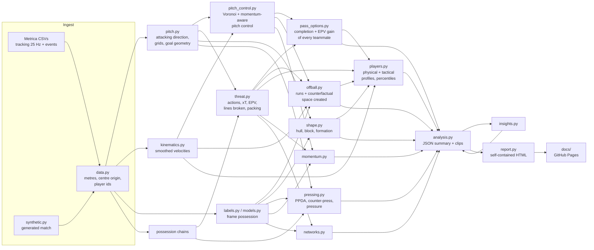
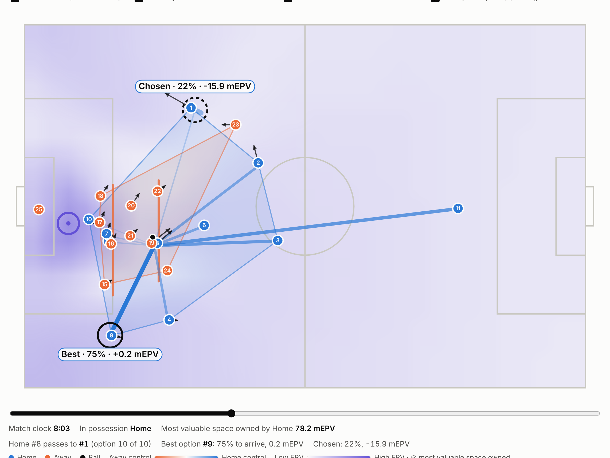
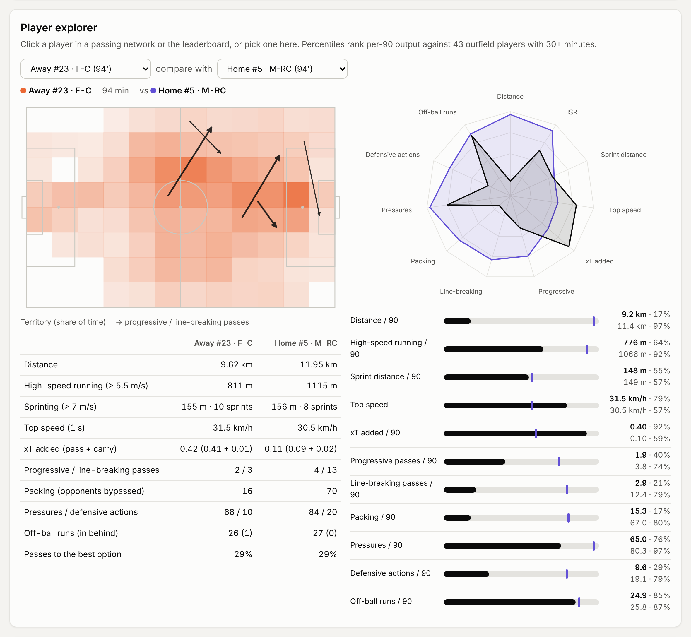
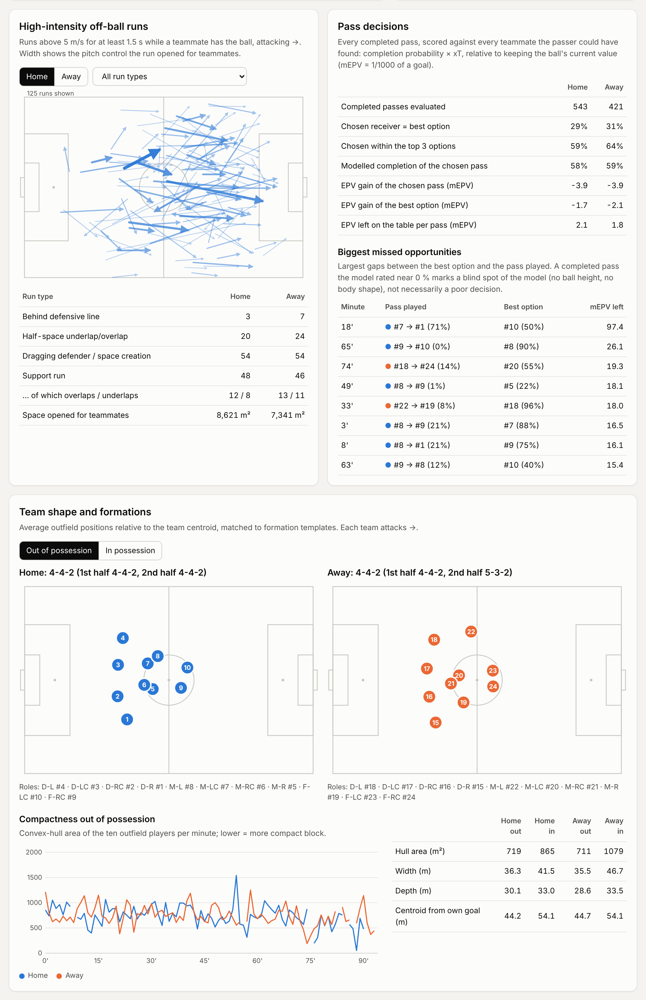

# symmetrica

[](https://github.com/yangpeduto/symmetrica/actions/workflows/tests.yml)

**Tactical analytics from football tracking data: possession, space, pressing, threat, off-ball runs, shape and players, frame by frame.**

**Live showcase:** [yangpeduto.github.io/symmetrica](https://yangpeduto.github.io/symmetrica/), both
matches as interactive reports in the browser (see [GitHub Pages](#github-pages)).

Event data tells you *when* something happens on the ball. Tracking data tells
you *where* all 22 players and the ball are, 25 times a second. symmetrica
combines the two to answer the questions an analyst asks about a match: who
had the ball and who owned the space, what each pass could have been, who
pressed and where, which runs pulled the defence apart, how compact the block
was, and what every player contributed physically and tactically. It ends in a
single interactive HTML match report per game.

Data: the open [Metrica Sports sample data](https://github.com/metrica-sports/sample-data)
(two anonymised matches, synchronised tracking + event data, 25 Hz).


## What it computes

| Question | Model | Module |
|---|---|---|
| Who has the ball, every frame? | Event-derived labels + a tracking-only *control with memory* model (93.4 % out-of-sample) | `labels.py`, `models.py` |
| Who owns which space? | Voronoi dominance (every frame) and pitch control with a **momentum-aware motion model** (bounded acceleration, 7 m/s²) | `pitch_control.py` |
| Where is the dangerous space? | **EPV surface**: attacking pitch control × expected threat | `threat.py` |
| Was it the right pass? | Completion probability (control at the receiver × lane interception risk) and EPV gain of **all ten teammates** at every pass | `pass_options.py` |
| Which runs pulled the defence apart? | High-intensity off-ball runs: in behind, overlap / underlap, dragged marker, with counterfactual space created | `offball.py` |
| How compact and in what shape? | Convex hull, block width / depth, line height; formations in and out of possession (Hungarian template matching) | `shape.py` |
| How hard and how high do they press? | PPDA, tracking pressure, counter-press regains < 5 s, high turnovers, recovery zones | `pressing.py` |
| Which actions create danger? | Expected threat (xT) by value iteration, inferred carries, progressive passes | `threat.py` |
| Which passes cut through the block? | Defensive lines from tracking, line-breaking passes, packing | `threat.py` |
| What did each player do? | Distance, high-speed running, sprints, top speed, xT, line-breaking passes, packing, pressures, runs; per 90 and as percentiles | `players.py` |
| When was each team on top? | xT momentum timeline with possession and space strips | `momentum.py` |
| How do they build up? | Passing networks at average in-possession positions | `networks.py` |
| What should a coach read first? | Rule-based tactical insights, each traceable to a number in the report | `insights.py` |

## Architecture



Everything below `data.py` works on plain pandas / NumPy tables in one
coordinate frame (metres, origin at the centre spot, x along the pitch), so
every model runs unchanged on the Metrica games and on synthetic matches.
Teams swap ends at half time; each metric converts to the acting team's
**attacking frame** (rotate 180° when the team attacks towards −x), which is
detected from the players' centroids at each kick-off.

## The models

### Possession (frame level)

Labels come from the event feed: a frame belongs to the team of the last
on-ball event (pass, shot, recovery, set piece, ball lost); after the ball
goes out or a foul is given nobody has it until play restarts. The
tracking-only estimator keeps the last team in control while the ball
travels and only switches when a player is within a control radius of a slow
enough ball; its thresholds are grid-searched on one match and tested on the
other.

| Model | Game 1 → test on Game 2 | Game 2 → test on Game 1 |
|---|---|---|
| Nearest player to the ball | 80.9 % | 80.3 % |
| **Control with memory** | **93.4 %** | **93.4 %** |
| Control with memory, ignoring ±0.5 s around a change of possession | 94.7 % | 94.6 % |


### Pitch control and space

**Voronoi dominance.** A location $r$ belongs to the team of the nearest
player. Vectorised over frames × cells × players, it runs on every frame of a
match (~9,000 frames/s).

**Probabilistic pitch control** (Spearman, 2018). The ball needs
$t_\text{ball}(r) = \lVert r - b \rVert / v_\text{ball}$ to reach $r$; player
$j$ needs an arrival time $\tau_j(r)$. Arrival is uncertain, so the chance he
is there by time $t$ is logistic in $t-\tau_j$, and once there he controls the
ball at rate $\lambda$:

$$\frac{dP_j}{dt} = \Big(1 - \sum_k P_k(t)\Big)\, f_j(t)\, \lambda_j, \qquad f_j(t) = \frac{1}{1 + e^{-\frac{\pi}{\sqrt{3}\,\sigma}(t - \tau_j)}}$$

integrated from $t_\text{ball}$ until the probabilities sum to 1 − 0.01. A
team's control of $r$ is $\sum_{j \in \text{team}} P_j$ ($\sigma$ = 0.6 s,
$\lambda$ = 4.3 s⁻¹, $v_\text{ball}$ = 15 m/s). The integration is vectorised
over all cells and players at once.

**Momentum-aware arrival times** (default). Spearman's original model has a
player keep his velocity for a 0.7 s reaction and then run straight at $r$ at
5 m/s, so a sprinter turns round for free. Here acceleration is bounded: the
player pushes with at most $a_\text{max}$ = 7 m/s² against a drag that caps his
speed at $v_\text{max}$ = 7.8 m/s (Fujimura & Sugihara, 2005),
$\dot v = a_\text{max} u - (a_\text{max}/v_\text{max})\, v$, $\lVert u\rVert \le 1$.
With $\alpha = a_\text{max}/v_\text{max}$ the points he can reach after $t$
seconds (after a 0.1 s perception delay $t_r$, coasting on his velocity) form a disk with

$$c(t) = p_j + v_j t_r + v_j \frac{1 - e^{-\alpha t}}{\alpha}, \qquad R(t) = v_\text{max}\Big(t - \frac{1 - e^{-\alpha t}}{\alpha}\Big)$$

so his momentum carries him on while he brakes, and from standing he
accelerates at exactly $a_\text{max}$. $\tau_j(r)$ is the first $t$ with
$\lVert r - c(t)\rVert \le R(t)$. A fast runner's disks are not nested (he can
pass through $r$ and be unable to stop there), so the root is found by a coarse
scan from an analytic lower bound followed by bisection, over only the
(cell, player) pairs still unresolved. Sprinting at 7 m/s, and before the delay, a point 10 m ahead
takes 1.4 s and a point 10 m behind 3.3 s (2.4 s from standing).

The 0.1 s delay and $\sigma$ = 0.6 s were chosen by cross-match validation of
pass completion (below): tuned on either match, the same values win on the other. Physics and linear models end up level on that test; the
physics model's advantage is that the arrival times themselves are physically
right (tested against the closed form), which matters for runs, turns and
counter-attacks rather than for an average pass.

**Expected possession value of space.**
$\text{EPV}(r) = \text{PC}_\text{att}(r) \cdot xT(r)$, with xT interpolated
bilinearly between cell centres. It highlights the dangerous space the team in
possession owns right now; the report marks its most valuable cell on every
frame.

**Pass options.** At every pass, each of the ten teammates $j$ is a candidate:

$$\text{completion}_j = \text{PC}_\text{att}(r_j)\,\Big(1 - \max_k I(\ell_{jk})\Big), \qquad I(\ell) = 1 - \prod_d \big(1 - F_d(t_\text{ball}(\ell))\big)$$

i.e. the passer's team must win the ball at the receiver, and no defender may
get within 1 m (leg reach) of the lane, sampled at 20 / 40 / 60 / 80 %, before
the ball does; $F_d$ is the same arrival-time distribution as above. The option's
value is $\text{completion}_j \cdot xT(r_j)$ and its gain is measured against
the ball's current $xT$. The best option is the largest gain; the report draws
all ten lanes, rings the best option and the receiver actually chosen, and
scores every completed pass of the match against its best alternative.

**Validation.** Completed passes are scored at their receiver; intercepted
passes at the teammate nearest the interception (the intended receiver is not
in the feed). Modelled completion separates the two with ROC AUC
0.835 (completed passes average 0.59, intercepted 0.23), against
0.827 for the linear model; out of sample (tuned on one match, tested on the
other), the physics model scores 0.835 / 0.821 vs 0.827 / 0.821 for the linear
model on game 2 / game 1: level on one match, slightly ahead on the other. The
ranking is what is validated: the probabilities are conservative (completed
passes average 0.59 while 88 % of passes in the feed are completed), so read
them as relative.



### Pressing and counter-pressing

The event feed is split into **possession chains** (runs of on-ball events by
one team with no stoppage). A chain that follows an opponent chain without a
stoppage is an open-play turnover.

$$\text{PPDA}_T = \frac{\text{opponent passes in zone}}{\text{defensive actions of } T \text{ in zone}}$$

where the zone is the 60 % of the pitch furthest from $T$'s goal and defensive
actions are ground challenges, tackles and interceptions made while the
opponent has the ball (aerial duels excluded, as in Opta's definition).
Lower PPDA means a more aggressive press.

- **Counter-press rate**: share of open-play losses won back within 5 s. From
  tracking, the average number of the losing team's players within 10 m of
  the ball in that window measures how many joined the press.
- **High turnovers**: open-play regains within 40 m of the opponent's goal,
  and how many of those chains end in a shot.
- **Pressure on the ball** (tracking): per frame, defenders within 5 m of the
  ball and the distance of the nearest one.

### Threat, progression and line-breaking

**Expected threat** (Singh, 2019) on a 12 × 8 grid in the attacking frame.
With shot probability $s_c$, move probability $m_c$, successful-move
transition matrix $T_{c \to z}$ and shot conversion $x_c$:

$$xT_c = s_c\, x_c + m_c \sum_z T_{c \to z}\, xT_z$$

solved by value iteration (converges in ~60 iterations). Two matches are thin
for 96 cells, so counts are smoothed with a Gaussian kernel over neighbouring
source cells, and $x_c$ comes from a geometric prior,

$$\operatorname{logit} x_c = -1.75 + 2.22\,\theta_c - 0.082\,d_c$$

($\theta$ = angle subtended by the goal mouth, $d$ = distance to goal),
calibrated to public rule-of-thumb values (≈0.6 six-yard box, ≈0.25 penalty
spot, ≈0.11 edge of the box, ≈0.04 at 25 m). The value of an action is
$xT(\text{end}) - xT(\text{start})$. Carries are not in Metrica's feed and are
inferred as the ball's displacement (≥ 3 m) between consecutive touches of the
same player within a chain.

- **Progressive pass** (Wyscout's rule): ≥ 30 m closer to goal inside the own
  half, ≥ 15 m when crossing halfway, ≥ 10 m inside the opponent half.
- **Defensive lines**: at the moment of each pass, the opponent outfielders'
  x positions (in the passer's attacking frame) are cut at the two largest
  gaps into up to three lines.
- **Line-breaking pass**: a completed pass that starts ≥ 2 m behind a line and
  is received ≥ 2 m beyond it. Counted per line broken.
- **Packing**: opponents goal-side of the ball when the pass is played minus
  opponents goal-side when it is received, both read from tracking.

### Off-ball runs and space creation

A **run** is at least 1.5 s above 5 m/s while a teammate has the ball, never
within 2 m of the ball (so the carrier's dribbles are excluded); dips under
0.2 s are bridged. In the runner's attacking frame the first matching rule
classifies it:

1. **Behind defensive line**: starts goal-side of the deepest outfield
   opponent, finishes beyond him, ≥ 5 m forward.
2. **Half-space overlap / underlap**: starts behind the ball carrier, finishes
   ahead of him on the same flank; outside of him is an overlap, inside an underlap.
3. **Dragging defender / space creation**: the nearest opponent at the start
   (≤ 8 m) follows him (moves ≥ 5 m and is still within 8 m), or the run opens
   ≥ 100 m² of control for teammates.
4. **Support run**: everything else.

**Space created** is counterfactual: pitch control at the end of the run is
recomputed with the runner (and the marker he dragged) put back where they
started. Outside an 8 m radius around the runner, the extra attacking control
is the space opened for teammates (m²), and the change in the best EPV spot
available to them is its value.

### Team shape and formations

Per frame (2.5 Hz), outfield players only: **convex-hull area** (monotone
chain + shoelace), **width** and **depth** of the block, and **centroid height**
above the own goal line, split into in / out of possession.

**Formation detection.** For each phase, every outfield player's position
relative to the team centroid is averaged (attacking frame, both halves folded
together). This shape and every template (4-4-2, 4-3-3, 4-2-3-1, 4-1-4-1,
4-4-1-1, 4-3-1-2, 4-5-1, 3-5-2, 3-4-3, 3-4-2-1, 5-3-2, 5-4-1) are standardised
per axis and matched by the Hungarian algorithm on squared distances; the
cheapest template wins and the assignment names each player's role (D-L = left
back, M-RC = right-centre midfielder, F-C = striker). Every template recognises
itself, and survives scaling and 1 m noise (tested).

### Player profiles

From tracking: **distance**, **high-speed running** (> 5.5 m/s) and **sprint
distance** (> 7 m/s) on a 0.4 s rolling mean of speed so single-frame tracking
spikes don't count, **sprints** (≥ 1 s), and **top speed** held for a full
second. From events and the models above: xT added (passing + carrying),
progressive and line-breaking passes, packing, **pressures** (spells ≥ 0.4 s
within 4 m of the ball while the opponent has it), defensive actions, off-ball
runs and pass-decision quality. Counting stats are also per 90; percentiles
rank each player against all outfield players of both matches with 30+ minutes.



### Momentum, networks, insights

- **Momentum** $m_t = \text{EWM}_{5\,\text{min}}\big(xT^\text{home}_t - xT^\text{away}_t\big)$,
  scaled to $[-1, 1]$, with per-minute possession and Voronoi-space strips.
- **Passing networks** place each player at his average position *while his
  team has the ball* (from tracking, both halves folded into one attacking
  direction); edges are completed passes between a pair.
- **Insights** are produced by explicit rules (e.g. "PPDA 4.5 vs 5.7 → Home
  pressed higher"), each carrying the numbers it is based on and a one-sidedness
  score; near-ties are reported as evenly matched instead of as a win.


## Results on the Metrica sample games

All values from `python scripts/report.py --game 1 --game 2 --json` (xT fitted
on both games pooled).

| | Game 1 Home | Game 1 Away | Game 2 Home | Game 2 Away |
|---|---|---|---|---|
| Goals | 3 | 0 | 3 | 2 |
| Possession | 52 % | 48 % | 51 % | 49 % |
| Space owned (Voronoi) | 52 % | 48 % | 48 % | 52 % |
| PPDA | 6.7 | 5.2 | 4.5 | 5.7 |
| Counter-press regains < 5 s | 45 % | 41 % | 46 % | 38 % |
| High turnovers | 16 | 15 | 20 | 28 |
| xT created | 2.73 | 0.76 | 1.82 | 1.33 |
| Progressive passes | 43 | 28 | 38 | 37 |
| Line-breaking passes | 102 | 95 | 97 | 88 |
| Opponents taken out (packing) | 557 | 399 | 576 | 502 |
| Shots / geometric xG | 18 / 3.84 | 6 / 0.35 | 13 / 2.75 | 11 / 1.96 |
| Passes to the best option | 27 % | 32 % | 29 % | 31 % |
| … within the top 3 options | 59 % | 62 % | 59 % | 64 % |
| EPV left per pass (mEPV) | 2.0 | 1.9 | 2.1 | 1.8 |
| High-intensity off-ball runs | 221 | 139 | 125 | 131 |
| … in behind / overlaps + underlaps | 21 / 28 | 10 / 25 | 3 / 20 | 7 / 24 |
| Space opened by runs (m²) | 13,421 | 7,845 | 8,621 | 7,341 |
| Block area out of possession (m²) | 832 | 788 | 719 | 711 |
| Block width × depth out of possession (m) | 37 × 31 | 38 × 32 | 36 × 30 | 35 × 29 |
| Formation out / in possession | 4-4-2 / 4-2-3-1 | 5-3-2 / 3-5-2 | 4-4-2 / 3-5-2 | 4-4-2 / 4-2-3-1 |

Game 1 reads as a one-sided 3–0 in threat terms (xT 2.73 vs 0.76, xG 3.84 vs
0.35) even though possession and space were almost even: the home side did
more with the ball rather than having more of it. The tracking-only metrics
say the same off the ball: home made 221 high-intensity runs to 139, twice as
many in behind (21 vs 10), and opened 13,400 m² of pitch control for teammates
against 7,800, while the away side defended in a back five (5-3-2). Game 2 was
closer in every dimension: both teams defended in a 4-4-2, home built up with a
back three (3-5-2) and away in a 4-2-3-1, and away won the ball high more often
(28 vs 20 high turnovers) while home pressed more aggressively by PPDA.

Pass decisions look alike for all four teams: the chosen receiver is the
model's best option on 27–32 % of passes and within its top three on ~60 %.
That is about what to expect when the model sees only position and velocity,
not body shape, the passer's view or the coach's plan.

Metrica's feed logs more duels than commercial providers, so absolute PPDA
values sit below typical league tables (8–12); comparisons between the two
teams are what the number is for here.

## Benchmarks

Measured by `python scripts/benchmark.py` on Metrica game 2 (94 min, 141,156
frames), Python 3.13, NumPy 2.5, SciPy 1.18, 4 vCPUs. Raw output in
[`results/benchmarks.json`](results/benchmarks.json).

| Step | Time |
|---|---|
| Load + parse tracking (2 CSVs) | 0.6 s |
| Velocities, every player, every frame | 0.4 s |
| Pitch control, one frame, 50 × 32, momentum-aware | 48 ms median (63 ms p95) |
| Pitch control, one frame, 32 × 21, momentum-aware | 20 ms median (26 ms p95) |
| Pitch control, one frame, 50 × 32, linear (Spearman) | 29 ms median |
| Arrival times, 1,600 cells × 22 players, momentum-aware | 28 ms |
| All ten pass options of every completed pass (964) | 2.7 s (2.8 ms per pass) |
| Off-ball runs (256) incl. counterfactual space | 6.8 s |
| Team shape, both teams at 2.5 Hz (28,232 samples) | 4.1 s |
| Voronoi dominance, every frame of the match | 15 s (≈9,207 frames/s) |
| Full report: every model + 5 animated clips | 35 s |
| Report file size (self-contained HTML) | 1.3–1.4 MB |

Pass-model validation from the same run (completed vs intercepted passes):

| Model | ROC AUC | Mean completion, completed | Mean completion, intercepted |
|---|---|---|---|
| Momentum-aware (default) | **0.835** | 0.59 | 0.23 |
| Linear, Spearman's defaults | 0.827 | 0.75 | 0.37 |

## The interactive report


`scripts/report.py` writes one HTML file per match with the data embedded and
all drawing done in vanilla JS (canvas + SVG): no network requests, no build
step, works offline and as an e-mail attachment. It contains

- a team comparison (20 metrics) and the average space-dominance map,
- the automated tactical insights,
- **animated replays** of the goals and the biggest line-breaking passes, with
  four layers to toggle:
  - **Pitch control / EPV heatmap** (or a live Voronoi diagram), with the most
    valuable space owned marked,
  - **velocity vectors and off-ball run trails** (the last 1.5 s of every
    detected run),
  - **defensive lines and team convex hulls**,
  - **best pass option and passing lanes**: all ten lanes weighted by
    completion probability, the best option against the one chosen;
- the momentum timeline with goals, shots, possession and space strips,
- passing networks, recovery maps and PPDA per 15 minutes,
- off-ball runs by type with the space each one opened, and pass decisions with
  the biggest missed opportunities,
- formations in and out of possession, and compactness over the match,
- the xT surface with the most valuable passes and a progression leaderboard,
- a **player explorer**: click any player in a network, the leaderboard or a
  formation to see his territory heatmap, progressive-pass map, physical and
  tactical numbers, and a radar + percentile bars, optionally against a second
  player,
- light and dark themes, phone layout.

Generated reports for both games are committed at
[`reports/game1.html`](reports/game1.html) and [`reports/game2.html`](reports/game2.html).



## GitHub Pages

`docs/` is a ready-made static site: a landing page (`docs/index.html`) linking
to both reports (`docs/game1.html`, `docs/game2.html`). The workflow in
[`.github/workflows/pages.yml`](.github/workflows/pages.yml) publishes it on
every push to `main` that touches `docs/`. One-time setup in the repository:
**Settings → Pages → Build and deployment → Source: GitHub Actions** (Pages on a
private repository needs a paid plan). Rebuild the site with:

```bash
python scripts/report.py --game 1 --game 2 --docs docs
```

## Quickstart

```bash
python -m venv .venv
```

```bash
.venv/bin/pip install -e ".[dev]"          # Windows: .venv\Scripts\pip
```

```bash
.venv/bin/python scripts/report.py --synthetic        # offline demo, no download
```

```bash
.venv/bin/python scripts/report.py --game 1 --game 2 --docs docs   # downloads the Metrica data on first run
```

```bash
.venv/bin/python -m pytest                            # 103 tests, ~15 s, no data needed
```

```bash
.venv/bin/python scripts/benchmark.py                 # timings + pass-model validation -> results/benchmarks.json
```

```bash
node scripts/screenshots.js reports/game2.html figures   # README / Pages screenshots (needs Node + Playwright)
```

The original possession study and its figures:

```bash
.venv/bin/python scripts/evaluate.py && .venv/bin/python scripts/figures.py && .venv/bin/python scripts/animate.py
```

Use it as a library:

```python
from symmetrica import data, analysis, report

track, events = data.tracking(2), data.events(2)
summary = analysis.analyse_match(track, events, name="Game 2")
report.write_report(summary, "reports/game2.html")
summary["pressing"]["home"]["ppda"], summary["shape"]["formations"]["away"]["out"]["formation"]
summary["decisions"]["home"]["best_option_share"], summary["offball"]["away"]["by_category"]
```

The raw data is downloaded from Metrica's repository into `data/` and is not
redistributed here.

## Tests

`tests/` holds 103 pytest cases that run without the Metrica download. Unit
tests build small hand-placed scenes whose answer is known analytically; the
integration tests run the full pipeline on a generated match.

- **Momentum-aware arrival times**: from standing they match the closed-form
  distance curve at every range, start at exactly $a_\text{max}$ and tend to
  $d/v_\text{max} + 1/\alpha$; isotropic at rest; for a sprinter, ahead < rest <
  sideways < behind with a turning cost close to a second; the *first* arrival
  is found for a runner passing through a point; reaction and reach behave.
- **Pitch control**: probabilities sum to 1 within tolerance; a mirrored 1 v 1
  gives mirrored surfaces and an exact 50/50 on the midline; a player owns the
  ground at his feet; running towards a space wins it; κ > 1 shifts contested
  balls; a defender sprinting away loses a ball he is level with; Voronoi
  matches brute force; attacking-frame bookkeeping across half time.
- **EPV and pass options**: EPV equals control × interpolated xT and flips with
  the attacking direction; xT interpolation hits cell centres; interception
  risk orders defenders by distance and combines independent chances; an open
  forward teammate beats one behind a defender and a backward pass has
  negative gain; decision ranks and "chose best" are consistent.
- **Off-ball runs**: detection needs speed, duration, teammate possession and
  distance from the ball; runs in behind, overlaps, underlaps and dragged
  markers are classified correctly in constructed scenes; space created is zero
  when nobody moves.
- **Shape and players**: hull area of known polygons; every formation template
  recognises itself and survives scaling + noise; the generated match is found
  to play 4-4-2 with the right keepers; distance, HSR, sprint and top speed from
  constant-speed runs; pressure spells; percentiles rank correctly and leave
  keepers out of the pool.
- **Pressing, threat, data, momentum, networks, insights**: as before (PPDA
  zones, counter-press windows, closed-form xT, progressive rule, defensive
  lines, packing, CSV parsing, momentum scaling, network positions, insight
  wording on wins, near-ties and missing values).
- **Report**: the summary is strict JSON with every new section; clips decode
  (pitch control, EPV, velocities, pass options); the HTML has no external
  resources and escapes a hostile match name; the landing page links every
  match; and (with Node + Playwright) the page renders in headless Chromium at
  phone width with no errors and no horizontal scroll, every layer toggles,
  and a leaderboard click opens the player explorer with a comparison radar.

## Project layout

```
src/symmetrica/
  data.py            Metrica CSV loading, metre coordinates, player ids
  pitch.py           grids, attacking direction, goal geometry, zones
  kinematics.py      smoothed velocities, per-frame snapshots
  labels.py          event-derived possession labels
  models.py          tracking-only possession estimators
  pitch_control.py   Voronoi dominance, momentum-aware Spearman pitch control
  pass_options.py    completion + EPV gain of every pass option, decision quality
  offball.py         off-ball run detection, classification, counterfactual space
  shape.py           convex hull, block width / depth, formation detection
  players.py         physical + tactical player profiles, percentiles
  pressing.py        possession chains, PPDA, counter-press, recoveries, pressure
  threat.py          actions + carries, xT, EPV, progressive / line-breaking passes, packing
  momentum.py        momentum timeline
  networks.py        passing networks
  insights.py        rule-based tactical insights
  analysis.py        runs everything on one match -> JSON summary
  report.py          renders report_template.html / landing_template.html
  synthetic.py       generated match for tests and demos
scripts/             evaluate.py, figures.py, animate.py, report.py, benchmark.py, screenshots.js
docs/                GitHub Pages site: index.html + both match reports
tests/               pytest suite
```

## Limitations

- **Two matches.** The xT surface is fitted on ~3,100 actions, which is why it
  is kernel-smoothed and uses a geometric xG prior instead of the ~50 shots in
  the data. Values are on a sensible scale but should not be compared with
  surfaces fitted on a season.
- **No ball height.** A lofted ball over a player still looks controllable to
  the possession model and to pitch control; line-breaking passes cannot tell
  "through" from "over" the line.
- **One physical profile for everyone.** Pitch control uses the same
  acceleration, top speed and reaction for all players, no goalkeeper
  parameters and no body orientation. On pass completion the momentum-aware
  model is level with Spearman's linear one, not better.
- **Pass options ignore the cost of losing the ball** (the opponent's counter
  threat) and treat every pass as a straight ground ball; the intended receiver
  of an intercepted pass is a guess, which limits the validation.
- **Off-ball run classes are rules**, with thresholds set by hand (5 m/s, 1.5 s,
  8 m); space creation is a counterfactual on one frame, not a causal effect.
- **Formations are templates.** Two matches give no labelled formations to
  check against; fluid or asymmetric shapes snap to the nearest template.
- **Event-derived possession is the ground truth** for possession-conditioned
  metrics, so a few seconds around each change of possession are ambiguous by
  construction.
- **Defensive lines from natural breaks** assume a compact block; against a
  very staggered shape the number of "lines" is less meaningful.

Next steps: learn per-player physical parameters from the tracking data (who
actually reaches loose balls), add the counter-threat of a lost ball to pass
values, and learn run types from labelled clips instead of rules.

## References

- W. Spearman (2018). *Beyond Expected Goals.* MIT Sloan Sports Analytics Conference.
- K. Singh (2019). *Introducing Expected Threat (xT).*
- L. Shaw, *Friends of Tracking* — open implementation of Spearman's model.
- T. Fujimura & K. Sugihara (2005). *Geometric analysis and quantitative evaluation of sport teamwork.* Systems and Computers in Japan.
- J. Fernández & L. Bornn (2018). *Wide Open Spaces: A statistical technique for measuring space creation in professional soccer.* MIT Sloan SAC.
- A. Bialkowski et al. (2014). *Large-scale analysis of soccer matches using spatiotemporal tracking data.* IEEE ICDM (role-based formations).
- H. W. Kuhn (1955). *The Hungarian method for the assignment problem.*
- Metrica Sports, *Sample Data* (tracking + events).

## Credits

Tracking and event data: © Metrica Sports, published as open sample data.
Built by Yang Peduto ([LinkedIn](https://www.linkedin.com/in/yang-peduto)).
