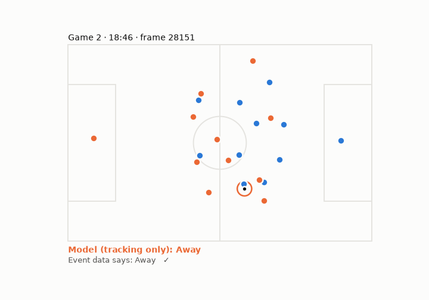
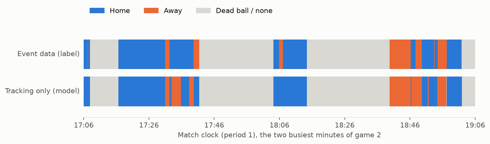
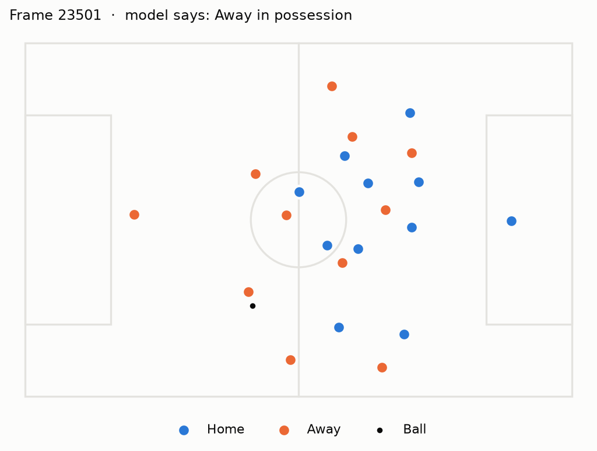

# symmetrica

**Who has the ball? Frame-by-frame team possession from tracking data alone.**

Event data tells you *when* something happens on the ball. Tracking data tells
you *where* all 22 players and the ball are, 25 times a second, but not who is
in possession. This project rebuilds possession for every frame from tracking
data only and checks it against the event feed.

Data: the open [Metrica Sports sample data](https://github.com/metrica-sports/sample-data)
(two anonymised matches, synchronised tracking + event data, 25 Hz).





## Results

Parameters are tuned on one match and evaluated on the other, so every number
below is out-of-sample.

| Model | Game 1 → test on Game 2 | Game 2 → test on Game 1 |
|---|---|---|
| Nearest player to the ball | 80.9 % | 80.3 % |
| **Control with memory** | **93.4 %** | **93.4 %** |
| Control with memory, ignoring ±0.5 s around a change of possession | 94.7 % | 94.6 % |

Accuracy = share of in-play frames where the model names the same team as the
event-based label. Dead-ball frames (after the ball goes out or after a foul)
are excluded.

## How it works

**Labels from events** (`src/symmetrica/labels.py`). A frame belongs to the team
of the last on-ball event (pass, shot, recovery, set piece, ball lost). After
the ball goes out or a foul is given, nobody has possession until play restarts.

**Baseline: nearest player.** Whichever team has the player closest to the ball.
It fails in the obvious place: during a pass the ball flies past opponents, and
the label flips every time it does.

**Control with memory** (`src/symmetrica/models.py`). Possession only changes
when a player is close enough to actually control the ball, and the ball keeps
belonging to the last team in control while it travels. A change only counts
after a few consecutive frames of control, which filters out deflections. The
three thresholds (control radius, maximum ball speed, minimum frames) are found
by grid search on the training match.



## Limitations

- The "ground truth" is itself derived from events, so a few seconds around
  each change of possession are ambiguous by construction (hence the tolerant
  column).
- Two matches is a small sample; the tuned radius sits at the lower end of the
  grid, which suggests the ball and player positions are clean enough that only
  genuine contact counts.
- No ball height: a lofted ball passing over a player's head can still look
  like control.

Next steps: use player velocity and orientation, model the ball in flight
explicitly, and replace the hand-set thresholds with a learned classifier.

## Run it

```bash
python -m venv .venv
.venv/Scripts/pip install -r requirements.txt      # macOS/Linux: .venv/bin/pip
.venv/Scripts/python scripts/evaluate.py           # downloads the data on first run
.venv/Scripts/python scripts/figures.py
.venv/Scripts/python scripts/animate.py
```

The raw data is downloaded from Metrica's repository into `data/` and is not
redistributed here.

## Credits

Tracking and event data: © Metrica Sports, published as open sample data.
Built by Yang Peduto ([LinkedIn](https://www.linkedin.com/in/yang-peduto)).
